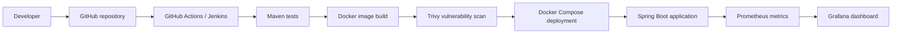

# Architecture

## Request and observability flow
1. A user calls `/api/status` or `/api/version`.
2. Spring Boot Actuator exposes health at `/actuator/health` and metrics at `/actuator/prometheus`.
3. Prometheus scrapes the application every 15 seconds.
4. Grafana reads Prometheus and displays request rate, p95 latency, heap memory, and target scrape status.

## Delivery flow
1. A commit or pull request triggers GitHub Actions.
2. Maven compiles the application and executes unit/integration tests.
3. Docker builds a multi-stage image with a non-root runtime user.
4. Trivy scans the image and fails the workflow for unfixed HIGH or CRITICAL vulnerabilities.
5. Jenkins deploys the `main` branch to the local Docker Compose environment and runs a smoke test.

This is a portfolio/lab deployment. It is not a highly available production architecture: it uses a single Docker host, local image storage, and no external secrets manager or orchestrator.
